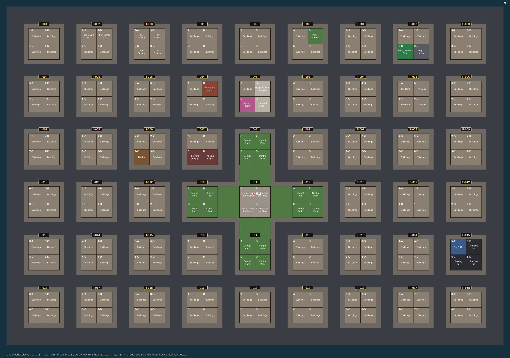

# The city map



To talk about a place, use its **block number** and **lot letter**: "002-C" is block 002, lot C (Eddy's).

- **Blocks** are numbered row by row from the north-west corner:

  ```
  001  002  003
  004  005  006
  007  008  009
  ```
- **Lots** in a block (each 5×5 tiles):

  ```
  A  B
  C  D
  ```
- Between the blocks are the streets (7 tiles: sidewalk, road, sidewalk). The red dot is where you start.
- In the code the same names are used: `lot('002', 'C')`, `block('008')` in `src/street/map.ts`.

This page and the picture are generated from the game's map: after changing `src/street/map.ts`, run
`npx vite-node scripts/map-doc.ts`.

| Lot | What's there | Tiles x | Tiles y |
|---|---|---|---|
| 001-A | Buildings | 58–62 | 7–11 |
| 001-B | Buildings | 63–67 | 7–11 |
| 001-C | Buildings | 58–62 | 12–16 |
| 001-D | Buildings | 63–67 | 12–16 |
| 002-A | Buildings | 75–79 | 7–11 |
| 002-B | Buildings | 80–84 | 7–11 |
| 002-C | Eddy's General Store | 75–79 | 12–16 |
| 002-D | Ray's Arms | 80–84 | 12–16 |
| 003-A | Buildings | 92–96 | 7–11 |
| 003-B | Park + barbecue | 97–101 | 7–11 |
| 003-C | Buildings | 92–96 | 12–16 |
| 003-D | Buildings | 97–101 | 12–16 |
| 004-A | Buildings | 58–62 | 24–28 |
| 004-B | Basketball court | 63–67 | 24–28 |
| 004-C | The bar | 58–62 | 29–33 |
| 004-D | Buildings | 63–67 | 29–33 |
| 005-A | Buildings | 75–79 | 24–28 |
| 005-B | Hospital (ward, upstairs) | 80–84 | 24–28 |
| 005-C | Candy store | 75–79 | 29–33 |
| 005-D | Hospital (lobby) | 80–84 | 29–33 |
| 006-A | Gas & Go | 92–96 | 24–28 |
| 006-B | Parking lot | 97–101 | 24–28 |
| 006-C | Parking lot | 92–96 | 29–33 |
| 006-D | Parking lot | 97–101 | 29–33 |
| 007-A | Buildings | 58–62 | 41–45 |
| 007-B | Buildings | 63–67 | 41–45 |
| 007-C | The Yard (thugs) | 58–62 | 46–50 |
| 007-D | The Yard (thugs) | 63–67 | 46–50 |
| 008-A | Central Park | 75–79 | 41–45 |
| 008-B | Central Park | 80–84 | 41–45 |
| 008-C | Central Park | 75–79 | 46–50 |
| 008-D | Central Park | 80–84 | 46–50 |
| 009-A | Buildings | 92–96 | 41–45 |
| 009-B | Buildings | 97–101 | 41–45 |
| 009-C | Buildings | 92–96 | 46–50 |
| 009-D | Buildings | 97–101 | 46–50 |
| I-001-A | Buildings | 7–11 | 7–11 |
| I-001-B | Buildings | 12–16 | 7–11 |
| I-001-C | Buildings | 7–11 | 12–16 |
| I-001-D | Buildings | 12–16 | 12–16 |
| I-002-A | Buildings | 24–28 | 7–11 |
| I-002-B | Buildings | 29–33 | 7–11 |
| I-002-C | Buildings | 24–28 | 12–16 |
| I-002-D | Buildings | 29–33 | 12–16 |
| I-003-A | The Factory | 41–45 | 7–11 |
| I-003-B | The Factory | 46–50 | 7–11 |
| I-003-C | The Factory | 41–45 | 12–16 |
| I-003-D | The Factory | 46–50 | 12–16 |
| I-004-A | Buildings | 7–11 | 24–28 |
| I-004-B | Buildings | 12–16 | 24–28 |
| I-004-C | Buildings | 7–11 | 29–33 |
| I-004-D | Buildings | 12–16 | 29–33 |
| I-005-A | Buildings | 24–28 | 24–28 |
| I-005-B | Buildings | 29–33 | 24–28 |
| I-005-C | Buildings | 24–28 | 29–33 |
| I-005-D | Buildings | 29–33 | 29–33 |
| I-006-A | Buildings | 41–45 | 24–28 |
| I-006-B | Buildings | 46–50 | 24–28 |
| I-006-C | Buildings | 41–45 | 29–33 |
| I-006-D | Buildings | 46–50 | 29–33 |
| I-007-A | Buildings | 7–11 | 41–45 |
| I-007-B | Buildings | 12–16 | 41–45 |
| I-007-C | Buildings | 7–11 | 46–50 |
| I-007-D | Buildings | 12–16 | 46–50 |
| I-008-A | Buildings | 24–28 | 41–45 |
| I-008-B | Buildings | 29–33 | 41–45 |
| I-008-C | Buildings | 24–28 | 46–50 |
| I-008-D | Buildings | 29–33 | 46–50 |
| I-009-A | Buildings | 41–45 | 41–45 |
| I-009-B | Buildings | 46–50 | 41–45 |
| I-009-C | Buildings | 41–45 | 46–50 |
| I-009-D | Buildings | 46–50 | 46–50 |
